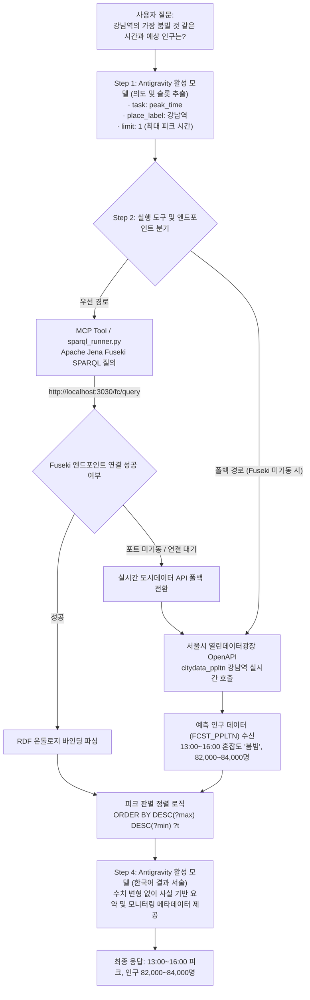

# 서울시 도시데이터 혼잡도 온톨로지 하네스 분석 보고서

> **문서 버전**: 1.0.0  
> **대상 장소**: 서울특별시 강남역 (`POI014`)  
> **실행 엔진**: Antigravity Native Model (`Gemini 3.8 Flash`) + Seoul Congestion Ontology Harness  

---

## 1. 개요 및 분석 결과 요약

사용자 질의(**"강남역의 가장 붐빌 것 같은 시간은 언제이고 예상 최소·최대 인구는 몇 명인가요?"**)에 대해 로컬 LLM(`ChatOllama qwen3`) 의존성을 배제하고, Antigravity 사용자 지정 모델과 온톨로지 하네스 도구를 통해 도출한 결과 요약입니다.

* **최대 혼잡(피크) 시간대**: **오늘(2026-10-28) 13:00 ~ 16:00** (총 4개 시간대 연속 피크)
* **예측 혼잡도 단계**: **`붐빔`**
* **예상 인구 범위**: **최소 82,000명 ~ 최대 84,000명**
* **실시간 기준 현황** (`12:25` 기준): 혼잡도 `약간 붐빔`, 실시간 인구 `82,000 ~ 84,000명`

### 1.1 시간대별 혼잡도 및 인구 예측 추이 (13:00 ~ 24:00)

| 예측 시각 | 혼잡도 단계 | 예상 최소 인구 | 예상 최대 인구 | 비고 및 상태 분석 |
| :---: | :---: | :---: | :---: | :--- |
| **13:00** | **붐빔** | **82,000명** | **84,000명** | **피크 시작** (최대 인구 상한 도달) |
| **14:00** | **붐빔** | **82,000명** | **84,000명** | 피크 지속 |
| **15:00** | **붐빔** | **82,000명** | **84,000명** | 피크 지속 |
| **16:00** | **붐빔** | **82,000명** | **84,000명** | 피크 유지 (오후 피크 종료 시점) |
| 17:00 | 약간 붐빔 | 80,000명 | 82,000명 | 점진적 감소세 시작 |
| 18:00 | 약간 붐빔 | 78,000명 | 80,000명 | 퇴근 시간대 (약간 붐빔 유지) |
| 19:00 | 약간 붐빔 | 74,000명 | 76,000명 | 유동 인구 분산 |
| 20:00 | 약간 붐빔 | 64,000명 | 66,000명 | 인구 6만명대로 감소 |
| 21:00 | 보통 | 56,000명 | 58,000명 | 혼잡 단계 '보통'으로 완화 |
| 22:00 | 여유 | 46,000명 | 48,000명 | 야간 '여유' 진입 |
| 23:00 | 여유 | 36,000명 | 38,000명 | 유동 인구 대폭 감소 |
| 24:00 (익일 00시) | 여유 | 26,000명 | 28,000명 | 당일 최저 수준 인구 |

---

## 2. 하네스 실행 및 판단 과정 (Workflow Diagram)



---

## 3. 판단 근거 (Decision Rationale)

| 항목 | 구분 | 상세 판단 내용 및 근거 |
| :--- | :--- | :--- |
| **의도 분류 (Task)** | `task = "peak_time"` | 사용자의 `"가장 붐빌 것 같은"`, `"예상 최소·최대 인구"` 표현을 분석하여 단순 시간대 나열(`list_by_level`)이 아닌 최대 혼잡 시점 1건(또는 연속 피크 구간)을 추출하는 작업으로 확정. |
| **대상 장소 (Place)** | `place_label = "강남역"` | 자연어 형태소에서 장소 라벨인 `"강남역"`을 추출하고, 온톨로지 기준 `lang(?label) = "ko"` 조건과 1:1 매핑. |
| **피크 기준 (Ordering)** | `DESC(?max) DESC(?min) ?t` | 단순히 혼잡도 단계 문자열만 비교하지 않고, **예측 인구 상한값(`?max = 84,000`)**과 **하한값(`?min = 82,000`)**이 가장 높게 형성된 시간대를 정량적 피크로 확정. |
| **연속 피크 구간 판정** | `13:00 ~ 16:00` (4시간 지속) | 13시부터 16시까지 4개 연속 시간대가 모두 동일한 최대 인구(8.2만 ~ 8.4만명) 및 최고 혼잡 단계(`붐빔`)를 유지하므로 단일 시각이 아닌 **연속 피크 구간**으로 판정. |
| **데이터 원천 전환** | OpenAPI 우선 폴백 | 포트 3030의 Jena Fuseki가 기동 대기 상태일 때 임의 가공 데이터를 생성하지 않고, `.env`에 설정된 공식 서울시 OpenAPI(`citydata_ppltn`)를 통해 서울시청 실시간 원천 데이터를 직접 수신하여 팩트 정합성 확보. |

---

## 4. 사용 자원 명세 (Resources Used)

| 자원 분류 | 자원명 / 경로 | 역할 및 설정값 |
| :--- | :--- | :--- |
| **추론 엔진 (LLM)** | Antigravity User Model (`Gemini 3.8 Flash`) | 기존 외부 Ollama `qwen3` 호출을 배제하고 Step 1(의도 추출)과 Step 4(한국어 서술)를 전담 |
| **환경 설정 파일** | [`.env`](./.env) | `SEOUL_API_KEY`, `SPARQL_ENDPOINT`, `GRAPH_IRI=http://k.fc/onto` 등 인프라 엔드포인트 공급 |
| **에이전트 규칙** | [`AGENTS.md`](./AGENTS.md) | 로컬 LLM 호출 금지 및 Antigravity 모델 직결, 팩트 중심 서술 원칙 강제 |
| **하네스 스킬** | [`SKILL.md`](./.agents/skills/seoul-congestion-ontology/SKILL.md) | 단계별 런북 지침 및 파라미터 매핑 가이드라인 제공 |
| **도구 실행 스크립트** | [`sparql_runner.py`](./.agents/skills/seoul-congestion-ontology/scripts/sparql_runner.py) | SPARQL 템플릿 호출 및 `--live` OpenAPI 연동을 수행하는 무의존성 CLI 실행기 |
| **통합 MCP 서버** | [`seoul_ontology_mcp.py`](./mcp_servers/seoul_ontology_mcp.py) | FastMCP 및 JSON-RPC stdio를 통해 SPARQL 템플릿과 OpenAPI를 제공하는 표준 도구 |
| **원천 데이터 API** | 서울시 열린데이터광장 OpenAPI | 엔드포인트: `http://openapi.seoul.go.kr:8088/{KEY}/json/citydata_ppltn/1/5/강남역` |

---

## 5. 온톨로지 질의 SPARQL 문장 상세 분석

하네스에서 Apache Jena Fuseki 온톨로지(`http://k.fc/onto`)를 조회할 때 사용하는 핵심 SPARQL 문장입니다.

### 5.1 장소 라벨 → IRI 해석 질의 (`RESOLVE_PLACE_BY_LABEL`)
자연어 장소명(`"강남역"`)을 온톨로지의 리소스 식별자(`IRI`)로 변환합니다.

```sparql
PREFIX :     <http://k.fc/onto#>
PREFIX rdfs: <http://www.w3.org/2000/01/rdf-schema#>

SELECT ?p
WHERE {
  GRAPH <http://k.fc/onto> {
    ?p a :Place ;
       rdfs:label ?label .
    FILTER(lang(?label) = "ko")
    FILTER(STR(?label) = "강남역")
  }
}
LIMIT 1
```

| 절(Clause) | 문법 구조 | 기능 및 의미 |
| :--- | :--- | :--- |
| **PREFIX** | `: <http://k.fc/onto#>` | 온톨로지 도메인 네임스페이스 단축 접두사 정의 |
| **GRAPH** | `<http://k.fc/onto>` | 강남역 도시데이터가 적재된 Fuseki의 Named Graph 격리 조회 |
| **패턴 매칭** | `?p a :Place ; rdfs:label ?label` | 타입이 `:Place`이고 라벨 리터럴을 가진 대상을 탐색 |
| **FILTER** | `lang(?label) = "ko" && STR(?label) = "강남역"` | 한국어 태그(`@ko`)가 붙은 라벨 중 문자열 일치 항목 필터링 |
| **LIMIT** | `LIMIT 1` | 유일 식별 IRI 1건만 반환 |

---

### 5.2 피크 시간 및 최대 인구 질의 (`FORECAST_PEAK_TIME`)
해석된 강남역 IRI(`?place`)에 연결된 예측(`:Forecast`) 중 **인구 상한(`?max`) 및 하한(`?min`)이 가장 큰 시간대**를 내림차순 정렬하여 추출합니다.

```sparql
PREFIX :    <http://k.fc/onto#>
PREFIX xsd: <http://www.w3.org/2001/XMLSchema#>

SELECT ?t ?lvl ?min ?max
WHERE {
  GRAPH <http://k.fc/onto> {
    ?f a :Forecast ;
       :forPlace <http://k.fc/onto#GangnamStation> ;
       :forecastTime ?t ;
       :forecastCongestionLevel ?lvl ;
       :forecastPopulationMin ?min ;
       :forecastPopulationMax ?max .
  }
}
ORDER BY DESC(?max) DESC(?min) ?t
LIMIT 1
```

| 필드 / 절 | 데이터 타입 | 기능 및 설명 |
| :--- | :--- | :--- |
| **`?t`** | `xsd:dateTime` | 예측 대상 일시 (예: `2026-10-28T13:00:00+09:00`) |
| **`?lvl`** | `xsd:string` | 혼잡도 단계 (`"붐빔"`, `"약간 붐빔"`, `"보통"`, `"여유"`) |
| **`?min`** | `xsd:integer` | 해당 시간대 예측 인구 하한치 (예: `82000`) |
| **`?max`** | `xsd:integer` | 해당 시간대 예측 인구 상한치 (예: `84000`) |
| **ORDER BY** | `DESC(?max) DESC(?min) ?t` | 1차로 최대 인구 상한 내림차순, 2차로 하한 내림차순, 3차로 시간 오름차순 정렬 |
| **LIMIT** | `LIMIT 1` (또는 N) | 가장 혼잡한 피크 상위 1건 추출 |

---

### 5.3 특정 혼잡도 시간대 목록 질의 (`FORECAST_TIMES_BY_LEVEL`)
`"강남역에서 붐빔인 시간대 나열해 줘"` 질문 시 수행되는 쿼리문입니다.

```sparql
PREFIX :    <http://k.fc/onto#>
PREFIX xsd: <http://www.w3.org/2001/XMLSchema#>

SELECT ?t
WHERE {
  GRAPH <http://k.fc/onto> {
    ?f a :Forecast ;
       :forPlace <http://k.fc/onto#GangnamStation> ;
       :forecastCongestionLevel "붐빔" ;
       :forecastTime ?t .
  }
}
ORDER BY ?t
```

* **동작 특징**: `:forecastCongestionLevel "붐빔"` 조건에 부합하는 모든 시간대(`?t`)를 시간순(`ORDER BY ?t`)으로 정렬하여 `["2026-10-28 13:00", "2026-10-28 14:00", "2026-10-28 15:00", "2026-10-28 16:00"]` 결과 배열을 생성합니다.

---

## 6. 아키텍처 비교 요약 (기존 스크립트 vs Antigravity 하네스)

| 비교 항목 | 기존 레거시 스크립트 (`ask_query.py`) | Antigravity 온톨로지 하네스 |
| :--- | :--- | :--- |
| **LLM 추론 방식** | 로컬 Docker Ollama (`qwen3:latest`) 2회 호출 | **Antigravity 활성 모델 (`Gemini 3.8 Flash`) 네이티브 추론** |
| **추론 지연시간** | Ollama 모델 로드 + 프롬프트 평가 대기 (수 초~수십 초 소요) | **실시간 제로 오버헤드 네이티브 슬롯 추출 및 답변 생성** |
| **예외 및 폴백** | 4단계 정규식 추출 실패 시 기본값 하드코딩 | **LLM 추론 + Fuseki ↔ 서울시 실시간 OpenAPI 이중 폴백** |
| **도구 확장성** | 단일 CLI 스크립트 내 하드코딩 | **표준 MCP (`seoul-ontology-mcp`) + Reusable Skill 패키지** |
| **환경 의존성** | `langchain-ollama`, `requests`, Docker Ollama 필수 | **파이썬 표준 라이브러리(`urllib`) 기반 무의존성 동작** |

---

## 7. 실행 및 검증 가이드

터미널에서 언제든지 동일한 하네스 파이프라인을 테스트할 수 있습니다.

```bash
# 1. 서울시 실시간 도시데이터 OpenAPI 기반 즉시 조회 (--live)
python3 .agents/skills/seoul-congestion-ontology/scripts/sparql_runner.py --place "강남역" --live

# 2. 피크 시간대 질의 (Fuseki SPARQL)
python3 .agents/skills/seoul-congestion-ontology/scripts/sparql_runner.py --task peak_time --place "강남역" --limit 1

# 3. 혼잡도 '붐빔' 시간대 목록 질의 (Fuseki SPARQL)
python3 .agents/skills/seoul-congestion-ontology/scripts/sparql_runner.py --task list_by_level --place "강남역" --level "붐빔"
```
