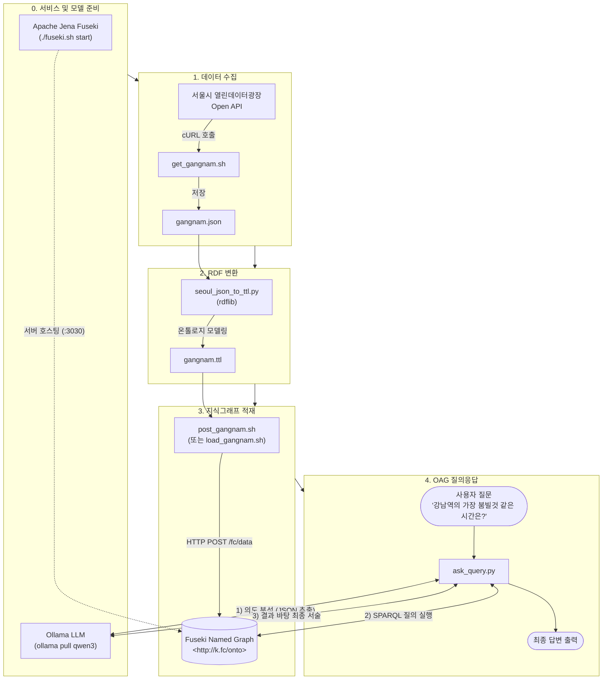

# Chapter 01 - OAG (Ontology-Augmented Generation)

서울시 실시간 도시데이터(인구 정보)를 수집하여 온톨로지(RDF/Turtle)로 변환하고, 이를 Apache Jena Fuseki 지식그래프에 적재한 뒤, 로컬 LLM(Ollama Qwen3)과 SPARQL을 결합하여 실시간 예측 정보를 질의응답하는 **OAG(온톨로지 증강 생성)** 파이프라인입니다.

---

## 1. 디렉토리 구조

```text
learn_ontology101-book/
├── .env                         # 프로젝트 공통 환경변수 (OLLAMA, FUSEKI, API KEY 등)
├── .env.example                 # 환경변수 템플릿 예시
├── fuseki.sh                    # Fuseki 서버 관리 스크립트
└── ch01-oag/
    ├── convert/                 # 데이터 수집, RDF 변환 및 Fuseki 적재
    │   ├── get_gangnam.sh       # 서울시 Open API 호출 및 JSON 저장 스크립트 (.env 연동)
    │   ├── seoul_json_to_ttl.py # JSON -> RDF/Turtle(.ttl) 변환 파이썬 스크립트
    │   ├── post_gangnam.sh      # TTL 파일을 Fuseki Graph Store에 POST 적재 (.env 연동)
    │   ├── load_gangnam.sh      # post_gangnam.sh의 심볼릭 링크
    │   ├── requirements.txt     # convert 모듈 의존성 (rdflib)
    │   ├── gangnam.json         # 수집된 강남역 실시간 인구 JSON 데이터
    │   └── gangnam.ttl          # 온톨로지 스키마 기반으로 변환된 Turtle 데이터
    └── oag/                     # 온톨로지 기반 질의응답 에이전트
        ├── ask_query.py         # 자연어 질문 -> LLM 의도 분석 -> SPARQL 질의 -> LLM 답변 (.env 연동)
        └── requirements.txt     # oag 모듈 의존성 (langchain, ollama, python-dotenv 등)
```

---

## 2. 파일별 기능 및 역할

### `convert/` (데이터 파이프라인)

| 파일 | 구분 | 주요 기능 및 설명 |
| :--- | :---: | :--- |
| [get_gangnam.sh](file:///apps/learn_ontology101-book/ch01-oag/convert/get_gangnam.sh) | Shell Script | **서울시 실시간 인구 데이터 수집**<br>• 서울시 열린데이터광장 `citydata_ppltn` API를 호출하여 강남역 인구 데이터를 cURL로 요청합니다.<br>• 타임스탬프 파일(`gangnam-[YYYYMMDDHHMM].json`) 및 기본 파일(`gangnam.json`)로 자동 저장합니다.<br>• 환경변수 `S_API_KEY`가 없을 경우 기본 인증키를 사용합니다. |
| [seoul_json_to_ttl.py](file:///apps/learn_ontology101-book/ch01-oag/convert/seoul_json_to_ttl.py) | Python Script | **JSON → RDF Turtle(.ttl) 온톨로지 변환**<br>• `rdflib`를 사용하여 수집된 JSON 데이터를 RDF 그래프 모델로 구조화합니다.<br>• `:Place`(장소 인스턴스), `:Forecast`(미래 인구 예측), `:Response`(응답 메타데이터) 엔티티 및 속성을 XSD/RDFS 데이터 타입에 맞춰 매핑합니다.<br>• 주요 옵션: `--input` (입력 JSON), `--output` (출력 TTL), `--base` (기본 IRI 접두사), `--place-code` 등 |
| [post_gangnam.sh](file:///apps/learn_ontology101-book/ch01-oag/convert/post_gangnam.sh) | Shell Script | **Fuseki Named Graph 데이터 적재 (SPARQL 1.1 HTTP Graph Store)**<br>• 생성된 `.ttl` 파일을 Apache Jena Fuseki 서버의 `/fc` 데이터셋에 POST 전송합니다.<br>• 기본 Named Graph IRI(`http://k.fc/onto` 또는 `http://k.gangnam/onto`)에 데이터를 적재하고 적재 완료 후 현재 적재된 총 트리플(Triple) 수를 자동 카운트하여 검증합니다. |
| [load_gangnam.sh](file:///apps/learn_ontology101-book/ch01-oag/convert/load_gangnam.sh) | Symlink | `post_gangnam.sh`를 가리키는 편의용 심볼릭 링크입니다. |
| [requirements.txt](file:///apps/learn_ontology101-book/ch01-oag/convert/requirements.txt) | Config | RDF 처리를 위한 파이썬 라이브러리(`rdflib>=7.0.0`) 명세입니다. |
| [gangnam.json](file:///apps/learn_ontology101-book/ch01-oag/convert/gangnam.json) | Data (JSON) | 서울시 공공 API로부터 응답받은 강남역 실시간 인구 및 예측 원본 데이터입니다. |
| [gangnam.ttl](file:///apps/learn_ontology101-book/ch01-oag/convert/gangnam.ttl) | Data (Turtle) | 온톨로지 어휘와 규칙에 따라 시맨틱 웹 트리플 구조로 변환된 지식그래프 파일입니다. |

### `oag/` (에이전트 질의응답)

| 파일 | 구분 | 주요 기능 및 설명 |
| :--- | :---: | :--- |
| [ask_query.py](file:///apps/learn_ontology101-book/ch01-oag/oag/ask_query.py) | Python Script | **OAG(온톨로지 증강 생성) 엔드투엔드 파이프라인**<br>1. **의도 분석 (LLM ①)**: 자연어 질문을 분석하여 작업 유형(`task: peak_time | list_by_level`), 대상 장소, 혼잡도 수준 등을 JSON으로 추출<br>2. **개체 연결 (Entity Linking)**: 장소 라벨(`rdfs:label "강남역"@ko`)을 조회하여 온톨로지 개체 IRI(`:Place`)로 해석<br>3. **SPARQL 실행**: 사전 정의된 템플릿에 파라미터를 바인딩하여 Fuseki 엔드포인트에 쿼리 전송<br>4. **답변 생성 (LLM ②)**: SPARQL 실행 결과를 바탕으로 사실에 기반한 명확한 한국어 설명 생성 |
| [requirements.txt](file:///apps/learn_ontology101-book/ch01-oag/oag/requirements.txt) | Config | Ollama LLM 및 SPARQL 호출 연동 라이브러리(`langchain-core`, `langchain-community`, `langchain-ollama`, `requests`) 명세입니다. |

---

## 3. 실행을 위한 주요 파일 순서 (Workflow)



---

## 4. 단계별 실행 방법

### Step 0. 필수 서비스 구동 및 환경변수 설정
```bash
# 1) 프로젝트 루트의 .env 설정 확인 (필요 시 API KEY 및 호스트 수정)
cat .env

# 2) Apache Jena Fuseki 서버 시작 (포트: 3030)
./fuseki.sh start

# 3) Ollama LLM 서비스 확인 (Docker 컨테이너: graphrag_agent_ai_ollama:11434)
# .env에 OLLAMA_BASE_URL=http://graphrag_agent_ai_ollama:11434 가 기본 지정되어 있습니다.
curl -s http://graphrag_agent_ai_ollama:11434/api/tags
```

### Step 1. 강남역 실시간 인구 데이터 수집
```bash
cd ch01-oag/convert

# 서울시 API에서 강남역 인구 JSON 수집 (gangnam.json 생성)
./get_gangnam.sh
```

### Step 2. JSON 데이터를 RDF(Turtle) 포맷으로 변환
```bash
# 의존성 패키지 설치
pip install -r requirements.txt

# JSON -> TTL 변환 실행
python3 seoul_json_to_ttl.py --input gangnam.json --output gangnam.ttl
```

### Step 3. Jena Fuseki 지식그래프에 데이터 적재
```bash
# gangnam.ttl 데이터를 Fuseki의 http://k.fc/onto 그래프에 적재
./post_gangnam.sh gangnam.ttl http://k.fc/onto

# (대안) 프로젝트 루트의 fuseki.sh 단축 명령어 사용 시
# ./fuseki.sh load-ch01
```

### Step 4. OAG 자연어 질의응답 실행
```bash
cd ../oag

# 의존성 패키지 설치
pip install -r requirements.txt

# 기본 질문 실행 ("강남역의 가장 붐빌것 같은 시간은 언제인가요?")
python3 ask_query.py

# 사용자 지정 질문 실행 예시
python3 ask_query.py --question "강남역에서 혼잡도가 붐빔인 시간대를 모두 알려줘"
```
