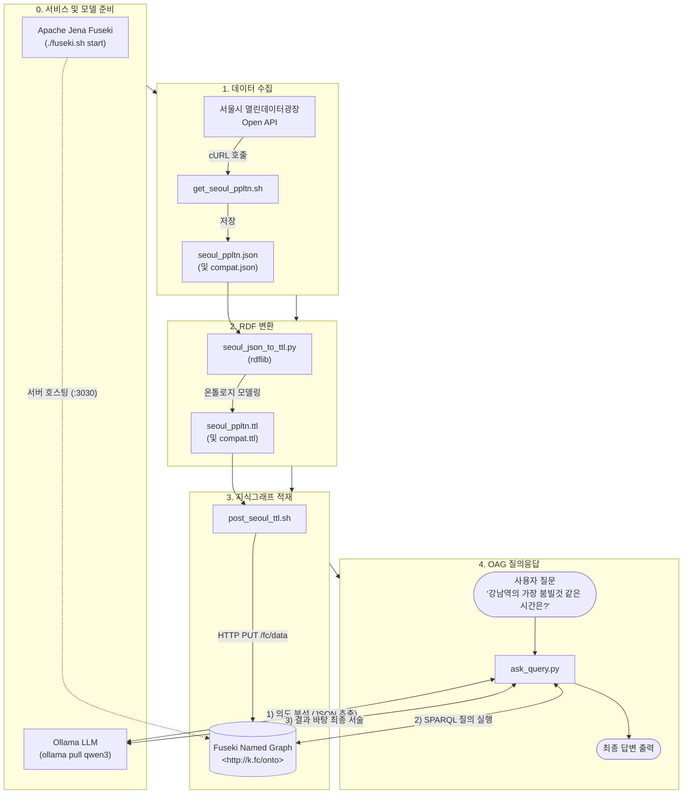

# Chapter 01 - OAG (Ontology-Augmented Generation)

서울시 실시간 도시데이터(인구 정보)를 수집하여 온톨로지(RDF/Turtle)로 변환하고, 이를 Apache Jena Fuseki 지식그래프에 적재한 뒤, 로컬 LLM(Ollama Qwen3)과 SPARQL을 결합하여 실시간 예측 정보를 질의응답하는 **OAG(온톨로지 증강 생성)** 파이프라인입니다.

---

## 1. 디렉토리 구조

```text
learn_ontology101-book/
├── .env                         # 프로젝트 공통 환경변수 (OLLAMA, FUSEKI, API KEY 등)
├── .env.example                 # 환경변수 템플릿 예시
├── fuseki.sh                    # Fuseki 서버 관리 스크립트
└── ch01-oag/
    ├── convert/                 # 데이터 수집, RDF 변환 및 Fuseki 적재
    │   ├── get_seoul_ppltn.sh   # 서울시 실시간 인구 API 수집 스크립트 (단일/복합 지역 지원)
    │   ├── seoul_json_to_ttl.py # JSON -> RDF/Turtle(.ttl) 변환 스크립트 (복합 지역 순회 변환)
    │   ├── post_seoul_ttl.sh    # TTL -> Fuseki Graph Store POST/PUT 적재 및 검증 스크립트
    │   ├── requirements.txt     # convert 모듈 의존성 (rdflib)
    │   ├── seoul_ppltn.json     # 수집된 복합 지역 실시간 인구 통합 JSON 데이터
    │   ├── seoul_ppltn.ttl      # 복합 지역 통합 Turtle 온톨로지 데이터
    │   ├── compat.json          # 복합 지역 실시간 인구 호환 JSON 데이터
    │   ├── compat.ttl           # 복합 지역 Turtle 온톨로지 호환 데이터
    │   ├── gangnam.json         # compat.json의 하위 호환 파일/심볼릭 링크
    │   └── gangnam.ttl          # compat.ttl의 하위 호환 파일/심볼릭 링크
    └── oag/                     # 온톨로지 기반 질의응답 에이전트
        ├── ask_query.py         # 자연어 질문 -> LLM 의도 분석 -> SPARQL 질의 -> LLM 답변 (.env 연동)
        └── requirements.txt     # oag 모듈 의존성 (langchain, ollama, python-dotenv 등)
```

---

## 2. 파일별 기능 및 역할

### `convert/` (데이터 파이프라인)

| 파일 | 구분 | 주요 기능 및 설명 |
| :--- | :---: | :--- |
| [get_seoul_ppltn.sh](file:///apps/learn_ontology101-book/ch01-oag/convert/get_seoul_ppltn.sh) | Shell Script | **서울시 실시간 인구 데이터 수집 (단일/복합 지역 지원)**<br>• 서울시 열린데이터광장 `citydata_ppltn` API를 호출하여 실시간 인구 데이터를 cURL로 요청합니다.<br>• 단일 지역뿐만 아니라 인자로 복수 핫스팟 목록(예: `강남역 역삼역 선릉역`)을 지정할 수 있으며, 생략 시 강남권 4대 주요 역(강남·역삼·선릉·신논현)을 자동 일괄 수집합니다.<br>• 수집된 데이터를 통합 JSON(`seoul_ppltn.json`) 및 하위 호환용 `compat.json` (및 `gangnam.json`)에 저장합니다. |
| [seoul_json_to_ttl.py](file:///apps/learn_ontology101-book/ch01-oag/convert/seoul_json_to_ttl.py) | Python Script | **JSON → RDF Turtle(.ttl) 온톨로지 변환 (복합 지역 지원)**<br>• `rdflib`를 사용하여 수집된 JSON 데이터를 RDF 그래프 모델로 구조화합니다.<br>• 복합 지역이 포함된 통합 JSON(`seoul_ppltn.json` 또는 `compat.json`)을 순회하며 모든 지역의 `:Place`, `:Forecast`, `:Response` 개체를 온톨로지 트리플로 변환합니다.<br>• 주요 옵션: `--input` (입력 JSON 목록), `--output` (출력 TTL), `--base` 등 |
| [post_seoul_ttl.sh](file:///apps/learn_ontology101-book/ch01-oag/convert/post_seoul_ttl.sh) | Shell Script | **Fuseki Named Graph 데이터 적재 및 적재 현황 검증**<br>• 생성된 `.ttl` 파일을 Apache Jena Fuseki 서버의 `/fc` 데이터셋에 전송합니다 (`PUT` 완전 갱신 또는 `--append`로 추가 병합).<br>• 적재 완료 후 Named Graph 내 적재된 총 트리플 수 및 장소별 예측 레코드 수를 SPARQL로 자동 조회하여 검증 리포트를 출력합니다. |
| [requirements.txt](file:///apps/learn_ontology101-book/ch01-oag/convert/requirements.txt) | Config | RDF 처리를 위한 파이썬 라이브러리(`rdflib>=7.0.0`) 명세입니다. |
| [seoul_ppltn.json](file:///apps/learn_ontology101-book/ch01-oag/convert/seoul_ppltn.json) | Data (JSON) | 복합 지역(강남역, 역삼역, 선릉역, 대림역 등)의 실시간 인구 및 예측 원본 통합 데이터입니다. |
| [seoul_ppltn.ttl](file:///apps/learn_ontology101-book/ch01-oag/convert/seoul_ppltn.ttl) | Data (Turtle) | 복합 지역 전체가 시맨틱 웹 트리플 구조로 모델링된 온톨로지 지식그래프 파일입니다. |
| [compat.json](file:///apps/learn_ontology101-book/ch01-oag/convert/compat.json) | Data (JSON) | 복합 지역 실시간 인구 및 예측 원본 호환 데이터입니다 (`gangnam.json` 호환). |
| [compat.ttl](file:///apps/learn_ontology101-book/ch01-oag/convert/compat.ttl) | Data (Turtle) | 복합 지역 온톨로지 지식그래프 호환 데이터입니다 (`gangnam.ttl` 호환). |

### `oag/` (에이전트 질의응답)

| 파일 | 구분 | 주요 기능 및 설명 |
| :--- | :---: | :--- |
| [ask_query.py](file:///apps/learn_ontology101-book/ch01-oag/oag/ask_query.py) | Python Script | **OAG(온톨로지 증강 생성) 엔드투엔드 파이프라인**<br>1. **의도 분석 (LLM ①)**: 자연어 질문을 분석하여 작업 유형(`task: peak_time | list_by_level`), 대상 장소, 혼잡도 수준 등을 JSON으로 추출<br>2. **개체 연결 (Entity Linking)**: 장소 라벨(`rdfs:label "강남역"@ko`)을 조회하여 온톨로지 개체 IRI(`:Place`)로 해석<br>3. **SPARQL 실행**: 사전 정의된 템플릿에 파라미터를 바인딩하여 Fuseki 엔드포인트에 쿼리 전송<br>4. **답변 생성 (LLM ②)**: SPARQL 실행 결과를 바탕으로 사실에 기반한 명확한 한국어 설명 생성 |
| [requirements.txt](file:///apps/learn_ontology101-book/ch01-oag/oag/requirements.txt) | Config | Ollama LLM 및 SPARQL 호출 연동 라이브러리(`langchain-core`, `langchain-community`, `langchain-ollama`, `requests`) 명세입니다. |

---

## 3. 실행을 위한 주요 파일 순서 (Workflow)



---

## 4. 단계별 실행 방법

### Step 0. 필수 서비스 구동 및 환경변수 설정
```bash
# 1) 프로젝트 루트의 .env 설정 확인 (필요 시 API KEY 및 호스트 수정)
cat .env

# 2) Apache Jena Fuseki 서버 시작 (포트: 3030)
./fuseki.sh start

# 3) Ollama LLM 서비스 확인 (Docker 컨테이너: graphrag_agent_ai_ollama:11434)
# .env에 OLLAMA_BASE_URL=http://graphrag_agent_ai_ollama:11434 가 기본 지정되어 있습니다.
curl -s http://graphrag_agent_ai_ollama:11434/api/tags
```

### Step 1. 실시간 인구 데이터 수집 (단일 또는 복합 지역)
```bash
cd ch01-oag/convert

# 1) 기본 실행: 강남권 4대 핫스팟 일괄 수집 (강남역, 역삼역, 선릉역, 신논현역)
./get_seoul_ppltn.sh

# 2) 특정 지역들만 지정하여 수집
./get_seoul_ppltn.sh 강남역 역삼역 선릉역

# 3) 단일 지역만 수집
./get_seoul_ppltn.sh 강남역
```

### Step 2. JSON 데이터를 RDF(Turtle) 포맷으로 변환
```bash
# 의존성 패키지 설치
pip install -r requirements.txt

# 수집된 통합 JSON -> 통합 Turtle(.ttl) 변환
python3 seoul_json_to_ttl.py --input seoul_ppltn.json --output seoul_ppltn.ttl
```

### Step 3. Jena Fuseki 지식그래프에 데이터 적재 및 검증
```bash
# 복합 지역 온톨로지 데이터를 Fuseki의 http://k.fc/onto 그래프에 적재 및 검증
./post_seoul_ttl.sh --replace seoul_ppltn.ttl http://k.fc/onto
```

### Step 4. OAG 자연어 질의응답 실행
```bash
cd ../oag

# 의존성 패키지 설치
pip install -r requirements.txt

# 기본 질문 실행 ("강남역의 가장 붐빌것 같은 시간은 언제인가요?")
python3 ask_query.py

# 사용자 지정 질문 실행 예시
python3 ask_query.py --question "강남역에서 혼잡도가 붐빔인 시간대를 모두 알려줘"
```
